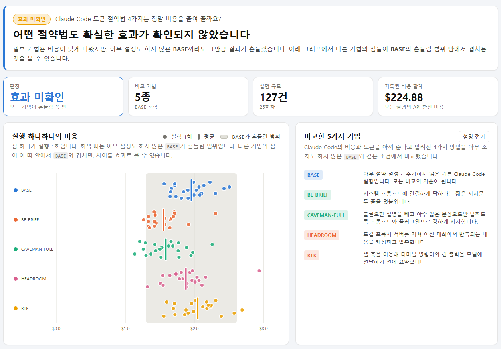

# Claude Code 토큰 절약 벤치마크

[](https://github.com/YangJunMan/claude-code-token-savings-benchmark/actions/workflows/ci.yml)
[](LICENSE)

Claude Code에 똑같은 개발 과제를 여러 번 시키면서, 토큰 절약 기법 4가지(`BE_BRIEF`, `CAVEMAN-FULL`, `HEADROOM`, `RTK`)가 아무 설정도 하지 않은 `BASE`보다 비용과 토큰을 실제로 줄여 주는지 직접 실험해 비교한 프로젝트입니다.

**[결과 대시보드 바로 보기](https://yangjunman.github.io/claude-code-token-savings-benchmark/)**



## 결과 요약

- **어떤 절약법도 확실한 효과가 확인되지 않았습니다.** `BE_BRIEF`와 `CAVEMAN-FULL`의 평균 비용이 `BASE`보다 약 18% 낮게 나왔지만, 같은 `BASE` 설정끼리도 실행할 때마다 비용이 ±33.7%씩 흔들려서 이 차이를 절약법의 효과로 볼 수 없습니다.
- **`HEADROOM`은 차이가 거의 없었고 `RTK`는 오히려 높았습니다.** `HEADROOM`의 평균 비용 차이는 −2.3%에 그쳤고, `RTK`는 평균 비용(+4.4%)과 토큰 사용량(+10.8%)이 모두 `BASE`보다 높게 나왔습니다.
- **성공한 130건은 기법에 관계없이 모두 공개 테스트를 통과했습니다.** 빠른 모델 업데이트와 구독 사용량 한도 때문에 2026-10-21에 추가 측정을 마쳤으며, 전체 기록은 그대로 보존해 두었습니다([측정 종료 보고서](docs/FINAL_REPORT.md)).

## 핵심 비교표

기본 과제(`small`)와 `claude-sonnet-5` 모델 기준 실행당 단순 평균입니다.

| 기법 | 평균 비용 (API 환산) | `BASE` 대비 비용 | `BASE` 대비 토큰 | 실행 수 |
|---|---:|---:|---:|---:|
| `BASE` | $1.91 | — | — | 26 |
| `BE_BRIEF` | $1.56 | −18.3% | −21.9% | 25 |
| `CAVEMAN-FULL` | $1.57 | −17.9% | −18.7% | 25 |
| `HEADROOM` | $1.87 | −2.3% | −1.3% | 24 |
| `RTK` | $2.00 | +4.4% | +10.8% | 25 |

<details>
<summary>세부 토큰 수치와 집계 기준 보기</summary>

| 기법 | 평균 총 사용 토큰 (처리 토큰) | 실행 수 | 비고 |
|---|---:|---:|---|
| `BASE` | 3,911,800 | 26 | 아무 조치도 하지 않은 비교 기준 |
| `BE_BRIEF` | 3,055,297 | 25 | 간결하게 답하라는 두 줄 지시 추가 |
| `CAVEMAN-FULL` | 3,178,759 | 25 | 극단적으로 짧은 말투 지시 및 플러그인 적용 |
| `HEADROOM` | 3,861,699 | 24 | 프록시 기반 이전 대화 중복 압축 |
| `RTK` | 4,334,640 | 25 | 셸 훅으로 긴 명령어 출력 요약 |

- 총 사용 토큰(처리 토큰)은 캐시에서 다시 읽은 토큰까지 합친 전체 처리량입니다.
- 위 표는 CLI 버전과 실행 시점이 섞여 있는 전체 단순 평균입니다(출처: [FINAL_REPORT.md](docs/FINAL_REPORT.md)).
- 웹 대시보드는 같은 날 실행한 `BASE`와 먼저 비교한 뒤 평균을 내고, 구버전 Claude Code CLI(2.1.267)로 실행한 24건을 평균에서 제외하기 때문에(`BASE` 22건, 나머지 기법 각 21건) 위 표와 숫자가 조금 다릅니다.

</details>

## 직접 해 보기

결과만 확인하려면 위 대시보드 링크를 열면 됩니다. 로컬에서 대시보드와 실험 서버를 직접 띄우려면 Git과 Python 3.11이 필요하며, 실제 실험까지 실행하려면 로그인된 Claude Code CLI가 필요합니다.

```bash
git clone https://github.com/YangJunMan/claude-code-token-savings-benchmark.git
cd claude-code-token-savings-benchmark
./quickstart.sh        # Windows PowerShell은 .\quickstart.ps1
```

실험은 사용자 승인 없이는 자동으로 실행되지 않으며, 실행할 때만 Claude 구독 사용량을 소비합니다.

## 자세히 보기

<details>
<summary>비교한 5가지 기법과 실험 과제</summary>

모든 실행에는 SQLite 기반 GPU 작업 관리 서비스를 구현하라는 동일한 과제를 주었고, 완성된 코드가 공개 테스트를 통과하는지 함께 기록했습니다.

- `BASE`: 아무 절약 설정도 추가하지 않은 기본 Claude Code 실행입니다.
- `BE_BRIEF`: 시스템 프롬프트에 간결하게 답하라는 지시문 두 줄을 덧붙입니다.
- `CAVEMAN-FULL`: 불필요한 설명을 빼고 아주 짧은 문장으로만 답하도록 지시합니다.
- `HEADROOM`: 로컬 프록시를 거쳐 이전 대화에서 중복되는 문맥을 캐싱하고 압축합니다([Headroom](https://github.com/chopratejas/headroom)).
- `RTK`: 셸 훅으로 터미널 명령어의 긴 출력을 미리 요약해 전달합니다([RTK](https://github.com/rtk-ai/rtk)).

(`CAVEMAN-FULL` 공식 저장소: [Caveman](https://github.com/JuliusBrussee/caveman))

</details>

<details>
<summary>알려진 한계</summary>

- **같은 설정끼리의 흔들림 폭(noise floor)이 큽니다.** 반복 횟수가 충분하지 않고 `BASE` 자체의 변동 폭이 넓어 작은 절감 효과는 구분할 수 없습니다.
- **품질은 공개 테스트 통과 여부만 확인합니다.** 숨겨진 채점 기준이나 코드 구조 평가는 포함하지 않습니다.
- **조건 간 대기 시간을 강제하지 않습니다.** 작업을 연달아 실행하면 앞선 실행의 프롬프트 캐시가 다음 실행에 영향을 줄 수 있습니다.
- **실제 실험은 macOS에서만 진행했습니다.** Linux와 Windows에서는 CI를 통해 단위 테스트와 스크립트 문법만 검증했습니다.
- **원인 진단은 정규식 패턴 기반입니다.** 테스트 실패 후 복구와 같은 파일 재읽기 사건만 자동으로 탐지합니다.

</details>

<details>
<summary>웹 대시보드 구성과 로컬 실행 방법</summary>

`web/` 폴더는 빌드 도구나 외부 라이브러리 없이 동작하는 정적 HTML/JS 대시보드입니다.

| 탭 | 볼 수 있는 내용 |
|---|---|
| 개요 | 전체 결론, `BASE` 대비 기법별 평균 차이 그래프, 전체 실험 기록 |
| 실행 상세 | 개별 실행의 `BASE` 대비 결과, 턴별 반복 청구 토큰(`context tax`), 원인 분석 |
| 결과 검증 | 날짜별 평균 비용 추이, 유효 실행 평균표, 실행별 원본 기록 |
| 실험 설정 | 실험할 기법 선택, 실행 계획 생성, 승인 및 큐 등록 (로컬 `token_bench serve` 필요) |

로컬에서 웹 대시보드만 단독으로 띄우려면 저장소 루트에서 아래 명령을 실행한 뒤 브라우저에서 `http://127.0.0.1:8765/web/`을 엽니다.

```bash
python3 -m http.server 8765
```

파일 탐색기에서 `index.html`을 직접 열면(`file://`) 브라우저 보안 정책 때문에 CSV 파일을 읽지 못하므로 반드시 HTTP 서버를 통해 열어야 합니다.

`quickstart.sh`(Windows는 `quickstart.ps1`)를 실행하면 조건별 도구 설치 여부를 점검한 뒤 로컬 API(`127.0.0.1:8787`)와 웹 서버(`127.0.0.1:8765`)를 함께 띄워 줍니다. 또는 저장소 안에서 Claude Code에 "토큰 실험 켜줘"라고 요청해 `.claude/skills/token-bench/` 스킬로 진행할 수도 있습니다.

</details>

<details>
<summary>실험 흐름과 CLI 명령어</summary>

웹의 실험 설정 탭과 터미널 CLI는 같은 내부 함수를 사용합니다. 모든 명령은 `python3.11 -m token_bench <명령>` 형태입니다.

| 명령 | 하는 일 | 모델 호출 |
|---|---|:---:|
| `inspect` | `benchmark/conditions.json`을 실행 목록으로 펼쳐 출력 | 없음 |
| `prepare` | 기법별 작업 폴더, 최종 프롬프트, 입력 스냅샷 생성 | 없음 |
| `preflight` | `claude` CLI, 구독 로그인, 필요 도구 설치 여부 점검 | 없음 |
| `estimate` | 실행 계획(`plan.json`)과 고유 요약값(`digest`) 생성 | 없음 |
| `approve` | 요약값(`digest`)을 확인해 일치할 때만 승인 파일(`approval.json`) 생성 | 없음 |
| `enqueue` | 승인을 소비하고 실행 큐(`.token-bench/state.db`)에 등록 | 없음 |
| `status` | 등록된 작업과 진행 상태 조회 | 없음 |
| `work` | 큐에 쌓인 작업을 순서대로 실행 (`--once`, `--exit-when-empty`) | 있음 |
| `result` | 실행 1건의 정규화된 결과 조회 | 없음 |
| `collect` | 턴 단위 CSV, 조건 비교표, 원인 진단 갱신 (`work` 완료 시 자동 호출) | 없음 |
| `publish` | 실행 요약을 `data/token-bench-results.csv`에 추가 (`work` 완료 시 자동 호출) | 없음 |
| `serve` | 웹 대시보드용 로컬 API 서버 실행 (`127.0.0.1` 전용) | 없음 |
| `add-condition` | 대화형 질문으로 새 절약법을 `conditions.json`에 등록 | 없음 |

자주 쓰는 옵션:

- `--only base,be-brief` 또는 `--exclude base`: 실행할 기법 고르기 (동시 사용 불가)
- `--skip-unavailable`: 도구가 설치되지 않은 기법은 안내 후 건너뛰기
- `--preset small|large|very-large` 또는 `--prompt <파일>`: 과제 프롬프트 선택 (동시 사용 불가)

터미널에서 직접 실행하는 예시:

```bash
python3.11 -m token_bench inspect
python3.11 -m token_bench preflight --skip-unavailable
python3.11 -m token_bench estimate --skip-unavailable --timeout-seconds 3600 --preset small
# 출력된 digest를 확인한 뒤:
python3.11 -m token_bench approve --plan .token-bench/runs/<batch_id>/plan.json --confirm <digest>
python3.11 -m token_bench enqueue --plan .token-bench/runs/<batch_id>/plan.json \
                                  --approval .token-bench/runs/<batch_id>/approval.json
python3.11 -m token_bench work --exit-when-empty
```

주요 안전장치:

- 조건, 반복 횟수, 입력 파일, 제한 시간 중 하나라도 바뀌면 요약값(`digest`)이 달라져 이전 승인을 재사용할 수 없습니다.
- 기본은 `--safe-mode`로 개인 스킬과 플러그인을 배제하며, 플러그인·훅 조건이 포함되면 `--setting-sources project`로 격리해 실행합니다.
- 실행이 끝나면 `benchmark/fixture/tests/` 공개 테스트를 돌리며, 테스트 파일이 삭제되거나 변조되었으면 실패로 기록합니다.

</details>

<details>
<summary>측정 지표 설명: 반복 청구 토큰 (context tax)</summary>

도구 실행 결과가 대화 문맥(컨텍스트)을 키우면 그 비용은 한 번으로 끝나지 않습니다. 대화가 끝날 때까지 이후 모든 턴이 그 내용을 다시 읽기 때문에 남은 턴 수만큼 거듭 청구됩니다. 이렇게 누적된 양을 **반복 청구 토큰(`context tax`)**이라고 부릅니다.

```
새로 들어온 결과(result) = 문맥 증가분 − 직전 턴 모델 출력
반복 청구 토큰(context tax) = 새로 들어온 결과 × 이후 남은 턴 수
```

예를 들어 5,000 토큰짜리 파일 읽기 결과 뒤에 25턴이 남았다면 총 125,000 토큰이 다시 읽히며 청구됩니다. 대화 도중 문맥 요약(`compaction`)이 일어나거나 항목별 합계가 전체 수치와 맞지 않는 실행은 `measurable=0`으로 표시하고 평균 집계에서 제외합니다. 자세한 계산식은 [활동 단위 토큰 측정](docs/ACTIVITY-LOG.md) 문서에 정리되어 있습니다.

</details>

<details>
<summary>새 절약법 추가하기</summary>

Python 코드를 수정할 필요 없이 아래 명령으로 질문에 답하면 `benchmark/conditions.json`에 새 기법이 추가됩니다.

```bash
python3.11 -m token_bench add-condition
```

자세한 선언 규칙과 예시는 [새 절약법 추가하기](docs/ADDING-A-SKILL.md) 문서를 참고하세요.

</details>

<details>
<summary>데이터 파일과 저장소 구조</summary>

`data/` 폴더는 웹 대시보드가 읽는 공개 측정 데이터입니다.

| 파일 | 기록 단위 | 내용 |
|---|---|---|
| `activity-log.csv` | 턴 | 턴별 토큰 사용량, 호출 도구, 반복 청구 토큰(`context tax`) |
| `run-summary.csv` | 실행 | 비용, 턴 수, 총 사용 토큰(`처리 토큰`), 공개 테스트 통과 여부, 집계 유효 여부 |
| `comparison.csv` | 회차 × 과제 × 기법 | 같은 회차 `BASE` 대비 증감률과 흔들림 폭(`noise floor`) |
| `run-diagnostics.json` | 실행 | 테스트 실패·복구, 파일 반복 읽기 등 감지된 사건 요약 |
| `token-bench-results.csv` | 실행 | 실행 결과 원본 기록 (결과 검증 탭) |

저장소 폴더 구조:

```
benchmark/
  conditions.json   기법 선언 목록 (새 절약법이 추가되는 곳)
  prompts/          과제 프롬프트, 프리셋, 기법별 추가 지시문
  settings/         기법별 Claude Code 설정
  fixture/          실험용 개발 과제와 공개 테스트
token_bench/        CLI, 점검·승인·큐 관리, 실행기, 집계, 원인 진단, 로컬 API
web/                정적 웹 대시보드 (외부 의존성 없음)
data/               공개 측정 데이터 CSV 및 JSON
docs/               상세 보고서와 가이드 문서
quickstart.sh       macOS · Linux · WSL 빠른 시작 스크립트
quickstart.ps1      Windows 빠른 시작 스크립트
```

</details>

<details>
<summary>관련 문서와 라이선스</summary>

| 문서 | 설명 |
|---|---|
| [FINAL_REPORT.md](docs/FINAL_REPORT.md) | 2026-10-21 측정 종료 기준 전체 데이터, 관측 결과, 한계 정리 |
| [ACTIVITY-LOG.md](docs/ACTIVITY-LOG.md) | 반복 청구 토큰(`context tax`) 정의, 검증 방법, 데이터 스키마 |
| [ADDING-A-SKILL.md](docs/ADDING-A-SKILL.md) | 새 절약법 선언 방법과 지원 범위 안내 |
| [FULL_REPORT.md](docs/FULL_REPORT.md) | 2026-09-06 초기 회차 상세 분석 보고서 (과거 평가 체계 기준) |

이 프로젝트는 MIT 라이선스를 따릅니다. 자세한 내용은 [LICENSE](LICENSE) 파일을 확인하세요.

</details>
